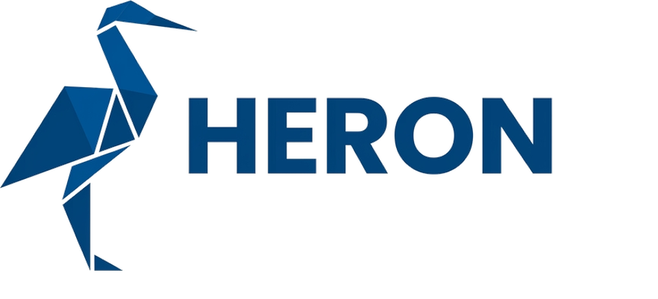

<div align="center">

<picture>
  <source media="(prefers-color-scheme: dark)" srcset="docs/brand/heron-lockup-dark.png">
  
</picture>

### With HERON, building sites is simple.

A site is a folder of markdown. HERON turns it into a ready static site or an nginx image.

[](https://github.com/FMSTM/HERON/actions/workflows/ci.yml)
[](https://github.com/FMSTM/HERON/pkgs/container/heron)
[](https://www.python.org/)

English | [Русский](README.ru.md)

</div>

---

## What HERON is

HERON is a static site engine delivered as a single Docker image, `ghcr.io/fmstm/heron`. The image does two things:

1. **create a site**: lay out a folder with a config, a theme and starter pages;
2. **build a site**: read the folder and produce HTML, a sitemap, markup, redirects and an nginx config.

The site itself is an ordinary folder: texts in markdown, images, a Jinja2 theme and one config, `site.yaml`. No database, no admin panel, no PHP. How the folder is organized, what the engine does with it and what it requires from it is written in the **contract**: [`docs/en/spec/20-data-contract.md`](docs/en/spec/20-data-contract.md).

```
     site folder                         HERON                          result
 ┌──────────────────┐          ┌───────────────────────┐        ┌─────────────────────┐
 │ site.yaml        │          │ contract check        │        │ dist/  - static      │
 │ content/<lang>/  │  ──────▶ │ markdown parsing      │ ─────▶ │   for any hosting    │
 │ media/  data/    │          │ links, languages, SEO │        │ or an nginx image    │
 │ theme/           │          │ theme rendering       │        │   with the site      │
 └──────────────────┘          └───────────────────────┘        └─────────────────────┘
```

## Quick start: one site, one engine

The usual case is one site and the stable engine version. All you need is Docker: how to install it, and how to do without it - [00 · Installation](docs/en/guide/00-install.md).

Open a terminal, go to the folder where your sites will live (for example, `mkdir -p ~/sites && cd ~/sites`) and run the commands one by one. You can copy them as is.

**1. Create a site.** The engine asks for the working language, the name, the domain and the site languages, and creates the folder `my-site` inside the current one:

```bash
docker run --rm -it -v "$PWD:/site" -w /site --user "$(id -u):$(id -g)" ghcr.io/fmstm/heron:prod new my-site
```

**2. Set it up in the configurator.** The engine prints the address `http://localhost:8000/#key` - open it in the browser in full, with the key after `#`. There you set the domains, the details for schema.org, publishing and the theme. "Save" writes `site.yaml` without touching your comments and the keys the configurator does not manage, and puts the publishing scripts if you want them. You can edit `site.yaml` by hand too. Done - Ctrl+C:

```bash
docker run --rm -it -p 127.0.0.1:8000:8000 -v "$PWD:/site" -w /site --user "$(id -u):$(id -g)" ghcr.io/fmstm/heron:prod setup my-site
```

**3. Look at it.** The site opens at <http://localhost:8000> and is rebuilt on every file save. A new site already has the white theme and its demo pages: the home page, "Blocks" (every kind of block), "Themes", "Documentation", the section "Structure":

```bash
docker run --rm -it -p 127.0.0.1:8000:8000 -v "$PWD:/site" -w /site --user "$(id -u):$(id -g)" ghcr.io/fmstm/heron:prod serve my-site
```

**4. Build it.** The finished site appears in `my-site/dist/`. This is a draft build (dev): it is closed to search engines and does not insert counters. The production build (prod) is the same command with `--env prod --strict` at the end:

```bash
docker run --rm -v "$PWD:/site" -w /site --user "$(id -u):$(id -g)" ghcr.io/fmstm/heron:prod build my-site
```

To look at the built folder - with a plain nginx at <http://localhost:8080>:

```bash
docker run --rm -p 127.0.0.1:8080:8080 -v "$PWD/my-site/dist:/usr/share/nginx/html:ro" \
  nginxinc/nginx-unprivileged:1.30.6-alpine
```

Good to know:

- **Without Docker** the engine is installed with pipx: `pipx install git+https://github.com/FMSTM/HERON.git@prod` (the package is not published to PyPI yet). Then everything in the commands up to and including the image name (`ghcr.io/fmstm/heron:…`) is replaced with the word `heron`: `heron new my-site`, `heron build my-site`.
- **Docker sees only the current folder**, so the path to the site is written from it: `my-site`, or `.` if you are already in the site folder (for example, in your own git repository - `.git` and `README` do not get in the way).
- **Changed the languages in `site.yaml`** - the command `init my-site` builds up the folders for them.
- **For agents and CI** - no questions and no `-it`, there is no terminal there: `docker run --rm -v "$PWD:/site" -w /site --user "$(id -u):$(id -g)" ghcr.io/fmstm/heron:prod new my-site --notes en --name Workshop --domain workshop.example --lang en,ru -y`.
- **Image resizing** runs in several processes. Where cores are shared with other tasks or processes are forbidden, set `--workers N` (`1` means no pool) or `HERON_WORKERS=N`. If the process pool is unavailable, the engine falls back to sequential resizing with the same result.

Step by step, with every step explained: [`docs/en/guide/02-first-site.md`](docs/en/guide/02-first-site.md).

## How to work with a site

**A page is a file, the engine works out the address.** How a file turns into an address is decided by three keys of `site.yaml`:

```yaml
site:
  domain: example.com        # domain: canonical, hreflang and sitemap are built from it
  default_lang: en           # the language served from the root
  languages: [en, ru]        # which content/ folders are read; the others live under /<lang>/
```

| File | with `default_lang: en` | with `default_lang: ru` |
|---|---|---|
| `content/en/index.md` | `/` | `/en/` |
| `content/en/about.md` | `/about/` | `/en/about/` |
| `content/ru/about.md` | `/ru/about/` | `/about/` |
| `content/ru/about.md` with `slug: o-nas` | `/ru/o-nas/` | `/o-nas/` |

- **Translations are linked by file name.** `en/about.md` and `ru/about.md` are one page in two languages, even if the Russian one has its own `slug`. Both get hreflang to each other, and `x-default` points to the version in the default language. No translation means no hreflang, and the language is grayed out in the switcher.
- **A language that is not in `languages` is not read.** The folder `content/de/` without `de` in the list is silently skipped.
- **`default_lang` changes all addresses at once.** On a live site this is a migration: the old addresses must be listed in `redirect_from` ([05 · SEO](docs/en/guide/05-seo.md#migrate-from-old-site)).

**Every file starts with a service block**, the SEO block of eight groups: basics, search queries, Open Graph, Twitter, schema.org, card, service, relations. The comments are hints: what the field means, when to fill it, what the engine fills in itself. The language of the comments is chosen when the site is created (`--notes ru|en`). Three fields are required: `title`, `h1`, `description`. The home page and the 404 page already have this block, a new page is `heron page add` (in all languages at once, with a question for every field) or a copy of a ready file with the values edited.

**After the block comes the text.** An intro, then sections `## Heading {#anchor}`, blocks that the theme puts in its places. A list, steps, questions and answers, a table are ordinary markdown; the engine understands the form by itself and gives the theme parsed data.

In detail: [concepts](docs/en/guide/01-concepts.md) · [first site](docs/en/guide/02-first-site.md) · [pages and content](docs/en/guide/03-content.md) · all `site.yaml` keys are in [`20` §5](docs/en/spec/20-data-contract.md#site-yaml).

## Commands

Thirteen commands. The path to the site defaults to the current folder. Here the commands are written short, with `heron` - this is how you run them if the engine is installed without Docker. With Docker the command is preceded by `docker run --rm -v "$PWD:/site" -w /site --user "$(id -u):$(id -g)" ghcr.io/fmstm/heron:prod`, plus `-it` for `new`, `setup`, `serve`, `page add`, `category add` and `init` in a folder without `site.yaml` (`new`, `init`, `page add` and `category add` ask questions, `setup` and `serve` stop with Ctrl+C), and `-p 127.0.0.1:8000:8000` for `setup` and `serve`, as in the quick start above.

| Command | What it does |
|---|---|
| `heron new <folder>` | creates a site: asks for the notes language, name, domain, languages and lays out the folder |
| `heron init <folder>` | builds the missing folders after the languages in `site.yaml` changed; `--agents` refreshes the instructions for agents |
| `heron page add <key>` | a page in all languages at once: missing - creates it with a ready SEO block, exists - opens it for editing; asks the fields with hints, `--answers`/`--dump` - without questions, `--category` - a section or a move with a 301 |
| `heron page list` | the tree of sections and pages: languages and what is not translated (`translation: pending`) |
| `heron category add <path>` | a section of any depth (`services/roofing`) in all languages: the page `_index.md`, the view of the list, the type of pages inside |
| `heron describe` | the description of the theme: types, blocks, fields and hints; `--json` - for an agent |
| `heron check <folder>` | checks the site against the contract without building; `--strict` turns warnings into errors, `--json` - machine-readable output, `--old-urls` - a check of the old addresses |
| `heron build <folder>` | builds `dist/`: HTML, sitemap, markup, redirects, nginx config; `--env prod` for a production build |
| `heron serve <folder>` | local preview with rebuild, the port is set by `--port`, the address by `--host` |
| `heron docs [topic]` | documentation of the same version as the engine; `--lang ru`/`--lang en`, `template <file>`, `--search <text>`, `--export <folder>`, `--all-langs` |
| `heron setup <folder>` | configurator in the browser: domains, languages, schema.org, publishing, theme; `--answers file` without a browser, `--dump` - current answers |
| `heron theme get\|list\|pack` | install a theme (starter, from the catalog, by link, from an archive), list, pack your own |
| `heron schema` | JSON Schema of the contracts of this version: `--site`, `--theme`, `--frontmatter`, `--setup`, `--errors`; `--lang ru`/`--lang en`, `--export <folder>` |
| `heron recipe` | Dockerfile of the nginx image for the built `dist/` |

The full list of flags is `heron <command> --help`. The language of the help, the messages and the comments in files is `--notes ru|en`, otherwise `HERON_NOTES`, otherwise `build.notes` from `site.yaml`, otherwise English.

Error codes (`E002`, `E006`, `E012`...) and their causes are in [`docs/en/spec/21-engine.md`](docs/en/spec/21-engine.md).

## The site folder contract

```
my-site/
├── site.yaml       config: domain, languages, theme, menu, SEO settings; the first key is heron: ">=0.3,<0.4"
├── content/<lang>/ pages in markdown, one folder per language
├── media/          images, video, documents
├── data/           yaml reference data: reviews, team, requisites
├── static/         files at an exact address: favicon, .well-known
├── theme/          theme: Jinja2 templates, styles, interface strings
├── plugins/        your own plugins, usually empty
├── agents/         instructions for agents, not part of the build (`--no-agents` turns it off)
├── AGENTS.md, CLAUDE.md, GEMINI.md   pointers to it
└── heron-readme.md notes on the folders
```

During a build the engine reads only these folders and writes only to the output folder (`dist/` or `--out`), to `.heron-cache/` and to the lock file `.<output folder>.heron-lock` next to it. What is allowed in each file is listed in the [data contract](docs/en/spec/20-data-contract.md).

## Theme

A theme is the `theme/` folder inside the site: `theme.yaml` (which page types and modules exist), Jinja2 templates, styles and interface strings. A template receives already parsed page data; you do not parse markdown yourself. The theme is developed right in the site; a finished one can be moved into a `heron-theme-<name>` package without changing the content. A local `theme/` always wins over an installed one. In detail: [04 · Theme and design](docs/en/guide/04-theme.md).

## Plugins

Plugins extend the **build**: your own section types, links between pages, Jinja filters, generators. They are ordinary pip packages (entry point group `heron.plugins`) installed where the build runs: build your own image based on the engine image and put its full name into `ENGINE`. For one-off needs of a single site, use the `plugins/<name>/` folder next to the content. A plugin from `site.yaml` that is not installed or failed on loading gives error `E014`. The site has no server code of its own - only static files. Form intake is moved to a separate service, `heron-relay`, which is not implemented yet: the engine checks the form description in `site.yaml`, but nobody accepts the POST. How themes and plugins are resolved: [`docs/en/spec/23-distribution.md`](docs/en/spec/23-distribution.md#theme-plugin-resolver).

## Safe run

A build needs nothing but the site folder, so everything else can be taken away from it:

```bash
docker run --rm \
  --network=none \
  --read-only --tmpfs /tmp \
  --cap-drop=ALL --security-opt=no-new-privileges \
  --user "$(id -u):$(id -g)" \
  -v "$PWD:/site" -w /site \
  ghcr.io/fmstm/heron:prod build . --strict
```

No network, a read-only root, no privileges, your own user, no `.env` and no docker socket. Raw HTML in markdown is off by default (`E015`). The finished site is served by `nginx-unprivileged` on port 8080. Full model: [`docs/en/spec/23-distribution.md`](docs/en/spec/23-distribution.md#security-model).

## What HERON does by itself and what you do

| By itself, without a single line | By hand, once or as you go |
|---|---|
| addresses from file paths, language prefixes | `site.yaml`: domain, languages, name, menu, counters |
| menu, section catalogs, breadcrumbs | page texts and the SEO block of every page |
| `sitemap.xml`, `robots.txt`, canonical addresses | theme: page type templates, modules, styles |
| hreflang and the language switcher | images go into `media/`, the engine resizes them itself |
| JSON-LD: page, breadcrumbs, FAQ, the site-wide node | data for the markup: the `schema` block in `site.yaml` |
| page cover: `og:image`, `twitter:image`, images in `sitemap.xml`, large previews | which image: `og_image` or `image` of the page, `seo.og_default_image` of the site |
| a check of the markup against the schema.org vocabulary (`SCH001`-`SCH006`) | fix the finding or record an exception in `schema_exceptions` |
| `llms.txt` and full texts for AI models | the facts about the site for them: `seo.llms_note` |
| image variants, WebP/AVIF, `srcset`, sizes | `alt` for images |
| 301 from old addresses, 410 for deleted ones | old addresses go to `redirect_from`, deleted ones to `gone` |
| a 404 page in every language, the nginx config | the 404 text: `content/<lang>/404.md` |
| a draft build closed to indexing | `--env prod` for the production one, `--out <folder>` to build somewhere other than `dist/` |
| a check of all this with clear errors | fix what the report points at |

What the engine can do, topic by topic: [`docs/en/roles/capabilities.md`](docs/en/roles/capabilities.md).

**For AI agents**: [`AGENTS.md`](AGENTS.md): roles, rules and boundaries are in `docs/<lang>/README.md`; the same folder lies in every new site as `agents/` and in the image (`heron docs --lang ru|en`).

## Several sites and engine versions

When there is more than one site or they need to be shipped as images, it is more convenient to work from a clone of this repository: `scripts/site.sh` keeps the settings of each site in its own file and does everything with one command.

```bash
git clone https://github.com/FMSTM/HERON.git && cd HERON
mkdir -p ~/sites                                 # site.sh new creates only the site folder, the parent must exist
./scripts/site.sh mysite new ~/sites/my-site     # create a site and its dev and prod environments
./scripts/site.sh mysite build dev               # build into out/mysite-dev
./scripts/site.sh mysite serve dev               # look at it on localhost:8080
./scripts/site.sh mysite build prod              # build the production version
./scripts/site.sh mysite image prod              # pack into an nginx image
./scripts/site.sh mysite smoke prod              # start the image and check the answers: 200, 404, 301, 410
./scripts/site.sh mysite push prod               # push the image to the registry
./scripts/site.sh mysite init                    # complete the folder for site.yaml
./scripts/site.sh mysite stop dev                # stop the preview
./scripts/site.sh mysite check dev               # check the content without building
```

The site name is lowercase Latin letters, digits and hyphens: the docker image name is built from it.

How it differs from one site:

| | One site | Several sites |
|---|---|---|
| What to run | `docker run … heron:prod` or `heron` from pipx | `scripts/site.sh` from a repository clone |
| Where the build settings are | command flags | `env/.env.<site>.<environment>`: path to the content, environment, engine, image and tag, strictness, port, registry and the folder with its login (keys: `env/.env.example`) |
| Where it builds | `dist/` inside the site folder | `out/<site>-<environment>`, the site folder is not touched |
| Which engine | the one you started | `ENGINE` in env: an exact version, `:prod` or sources next to it |
| Site image | build by hand | `site.sh image`, check with `site.sh smoke` |

**The engine version is pinned in the site itself**: the first key of `site.yaml` is `heron: ">=0.3,<0.4"`. An engine that does not fit refuses to build (`E012`). This way two sites can live on different versions, and updating the engine is changing one line.

`image`, `serve`, `smoke` and `push` pack what is already in `out/` and build the site themselves only on the first run. If you edited the content, run `build` first.

**Which images exist.** Sites are built with the tag `:prod` or an exact version `:X.Y.Z`. `latest` is the latest release tag without a suffix; an exact version is better for sites. `:beta` and `:dev` are development branches of the engine itself; a draft build of a site is the `--env` flag, not a different image.

**A site in its own repository** builds an image without a HERON clone and without its own Dockerfile, with the reusable workflow `FMSTM/HERON/.github/workflows/site-image.yml`, with a single `uses:` line.

In detail: [`docs/en/guide/06-deploy.md`](docs/en/guide/06-deploy.md).

## Documentation

The documentation in a branch corresponds to the image with the same name: `prod` is `:prod`, `beta` is `:beta`. Which image you have is shown by `heron --version` (branch and commit). The same documentation is in the image itself: `heron docs` is the table of contents, `heron docs <topic>`, `heron docs --search <text>`, `heron docs --export <folder>`.

**The path for a newcomer, in order:**

| | |
|---|---|
| [00 · Installation](docs/en/guide/00-install.md) | Docker or Python: what to install and how to check |
| [01 · Concepts](docs/en/guide/01-concepts.md) | site = folder, key and address, type, section, theme, the engine separate |
| [02 · First site](docs/en/guide/02-first-site.md) | from an empty folder to an image |
| [03 · Pages and content](docs/en/guide/03-content.md) | SEO block, sections, links, images, catalogs, languages |
| [04 · Theme and design](docs/en/guide/04-theme.md) | `theme.yaml`, templates, modules, what the template sees |
| [05 · SEO](docs/en/guide/05-seo.md) | what is generated by itself, what to fill in, moving from an old site |
| [06 · Build and deploy](docs/en/guide/06-deploy.md) | folder or image, several sites, engine versions |

**Reference: the contract and the design:**

| | |
|---|---|
| [20 · Data contract](docs/en/spec/20-data-contract.md) | site folder, URL, languages, markdown, all fields and keys, `theme.yaml`, images |
| [21 · Engine](docs/en/spec/21-engine.md) | build pipeline, page model, generators, commands, error codes |
| [22 · Deploy](docs/en/spec/22-deploy.md) | nginx, site CI, migration |
| [23 · Distribution](docs/en/spec/23-distribution.md) | image, commands, site image, themes and plugins, security |
| [Architecture](docs/en/architecture.md) | what consists of what, on one page |

What changed: [CHANGELOG.md](CHANGELOG.md).

**For agents:** [`AGENTS.md`](AGENTS.md) is the pointer; the instruction by roles (architect, content and SEO, designer, builder) is in [`docs/en/README.md`](docs/en/README.md).

## Engine development

```bash
git clone git@github.com:FMSTM/HERON.git && cd HERON
uv sync --group dev
uv run pre-commit install   # core boundary and ruff on every commit
./scripts/check.sh          # core boundary, commit messages, translation, lock file, format, linter, tests: the same set of checks as the CI job; the browser test and the image are checked by CI separately
```

Branches: `dev` is development, each feature in its own branch; `beta` is trying out on live sites; `prod` is what the sites run on. A release is the tag `vX.Y.Z`. Branches move forward without merges (`dev` → `beta` → `prod`); pushes to branches, tags and image publishing are done only by the repository owner.

**The core boundary:** the engine knows nothing about any particular site: no names, no domains, no sections. It is checked by `scripts/check-boundaries.sh`: always in CI, on a commit if pre-commit is installed.

## Status and license

Version 0.1. Until 1.0 the contract of `site.yaml` and `theme.yaml` may change in minor versions; a site pins a version range in `site.yaml` and moves deliberately.

The project is licensed under Apache-2.0; the full text is in the [LICENSE](LICENSE) file.

## Third-party data

The markup check uses the schema.org vocabulary, release 29.3 (a compact index in `heron/schemaorg/schemaorg-29.3.json`). Source: https://schema.org. License: [Creative Commons Attribution-ShareAlike 3.0](https://creativecommons.org/licenses/by-sa/3.0/) (CC BY-SA 3.0). The data keeps this license and is not covered by the license of the engine.
