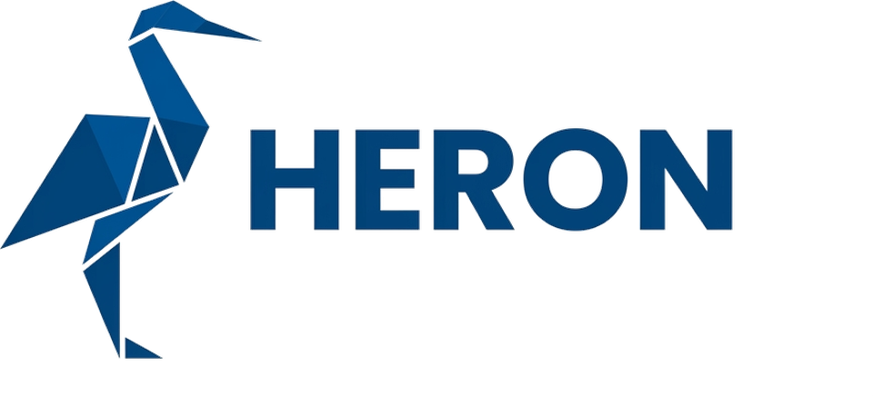

<div align="center">

<picture>
  <source media="(prefers-color-scheme: dark)" srcset="docs/brand/heron-lockup-dark.png">
  
</picture>

### С HERON создавать сайты — просто.

Сайт — это папка с markdown. HERON превращает её в готовый статический сайт или в образ nginx.

[](https://github.com/FMSTM/HERON/actions/workflows/ci.yml)
[](https://github.com/FMSTM/HERON/pkgs/container/heron)
[](https://www.python.org/)

[English](README.md) | Русский

</div>

---

## Что такое HERON

HERON — движок статических сайтов, который приходит одним образом `ghcr.io/fmstm/heron`. Образ умеет две вещи:

1. **создать сайт** — разложить папку с конфигом, темой и стартовыми страницами;
2. **собрать сайт** — прочитать папку и выдать HTML, карту сайта, разметку, редиректы и конфиг nginx.

Сайт при этом — обычная папка: тексты в markdown, картинки, тема на Jinja2 и один конфиг `site.yaml`. Ни базы, ни админки, ни PHP. Как устроена папка, что движок с ней делает и что от неё требует, записано в **контракте** — [`docs/ru/spec/20-data-contract.md`](docs/ru/spec/20-data-contract.md).

```
     папка сайта                         HERON                          результат
 ┌──────────────────┐          ┌───────────────────────┐        ┌─────────────────────┐
 │ site.yaml        │          │ проверка контракта    │        │ dist/  — статика     │
 │ content/<язык>/  │  ──────▶ │ разбор markdown       │ ─────▶ │   на любой хостинг   │
 │ media/  data/    │          │ ссылки, языки, SEO    │        │ или образ nginx      │
 │ theme/           │          │ рендер темы           │        │   с сайтом внутри    │
 └──────────────────┘          └───────────────────────┘        └─────────────────────┘
```

## Как работаешь с сайтом

**Страница — это файл, адрес считает движок.** Как файл превращается в адрес, решают три ключа `site.yaml`:

```yaml
site:
  domain: example.com        # домен: из него строятся canonical, hreflang и sitemap
  default_lang: en           # язык, который отдаётся из корня
  languages: [en, ru]        # какие папки content/ читаются; остальные — под /<язык>/
```

| Файл | при `default_lang: en` | при `default_lang: ru` |
|---|---|---|
| `content/en/index.md` | `/` | `/en/` |
| `content/en/about.md` | `/about/` | `/en/about/` |
| `content/ru/about.md` | `/ru/about/` | `/about/` |
| `content/ru/about.md` со `slug: o-nas` | `/ru/o-nas/` | `/o-nas/` |

- **Переводы связываются по имени файла.** `en/about.md` и `ru/about.md` — одна страница на двух языках, даже если у русской свой `slug`. Обе получают hreflang друг на друга, а `x-default` указывает на версию языка по умолчанию. Перевода нет — нет и hreflang, в переключателе язык погашен.
- **Язык, которого нет в `languages`, не читается.** Папка `content/de/` без `de` в списке молча пропускается.
- **`default_lang` меняет все адреса сразу.** На живом сайте это переезд: старые адреса надо перечислить в `redirect_from` ([05 · SEO](docs/ru/guide/05-seo.md#migrate-from-old-site)).

**Каждый файл начинается со служебного блока** — SEO-блока из восьми групп: основное, ключевые запросы, Open Graph, Twitter, разметка, карточка, служебное, связи. В комментариях — подсказки: что значит поле, когда его заполнять, что движок подставит сам. Язык комментариев выбирается при создании сайта (`--notes ru|en`). Обязательны три поля: `title`, `h1`, `description`. Главная и 404 приходят с этим блоком, новая страница — `heron page` или копия готового файла с правкой значений.

**После блока — текст.** Вступление, затем секции `## Заголовок {#якорь}` — блоки, которые тема ставит на свои места. Список, шаги, вопросы-ответы, таблица — обычный markdown, форму движок понимает сам и отдаёт теме разобранные данные.

Подробнее: [понятия](docs/ru/guide/01-concepts.md) · [первый сайт](docs/ru/guide/02-first-site.md) · [страницы и контент](docs/ru/guide/03-content.md) · все ключи `site.yaml` — [`20` §5](docs/ru/spec/20-data-contract.md#site-yaml).

## Команды

Одиннадцать команд. Путь к сайту по умолчанию - текущая папка.

| Команда | Что делает |
|---|---|
| `heron new <папка>` | создаёт сайт: спрашивает язык пояснений, название, домен, языки и раскладывает папку |
| `heron init <папка>` | достраивает папки после смены языков в `site.yaml` |
| `heron page <тип> <slug>` | добавляет страницу с готовым SEO-блоком |
| `heron check <папка>` | проверяет сайт по контракту, ничего не собирая; `--strict` превращает предупреждения в ошибки |
| `heron build <папка>` | собирает `dist/`: HTML, sitemap, разметку, редиректы, конфиг nginx; `--env prod` для боевой сборки |
| `heron serve <папка>` | локальный просмотр с пересборкой, порт задаёт `--port` |
| `heron docs [тема]` | документация той же версии, что и движок; `--search <текст>`, `--export <папка>` |
| `heron setup <папка>` | анкета в браузере: домены, языки, schema.org, публикация, тема; `--answers файл` без браузера, `--dump` - текущие ответы |
| `heron theme get\|list\|pack` | поставить тему (starter, из каталога, по ссылке, архивом), список, упаковать свою |
| `heron schema` | JSON Schema контрактов этой версии; `--export <папка>` |
| `heron recipe` | Dockerfile образа nginx для собранного `dist/` |

В контейнере это тот же вызов через `$H` из раздела «Быстрый старт». Коды ошибок (`E002`, `E006`, `E012`...) и их причины - в [`docs/ru/spec/21-engine.md`](docs/ru/spec/21-engine.md).

## Контракт папки сайта

```
мой-сайт/
├── site.yaml       конфиг: домен, языки, тема, меню, SEO-настройки; первая строка - heron: ">=0.1,<0.2"
├── content/<язык>/ страницы в markdown, по папке на язык
├── media/          картинки, видео, документы
├── data/           yaml-справочники: отзывы, команда, реквизиты
├── static/         файлы по точному адресу: favicon, .well-known
├── theme/          тема: шаблоны Jinja2, стили, строки интерфейса
└── plugins/        свои плагины, обычно пусто
```

Движок читает только эти папки и пишет только в `dist/` и `.heron-cache/`. Что допустимо в каждом файле, перечислено в [контракте данных](docs/ru/spec/20-data-contract.md).

## Тема

Тема - папка `theme/` внутри сайта: `theme.yaml` (какие типы страниц и модули есть), шаблоны Jinja2, стили и строки интерфейса. Шаблон получает уже разобранные данные страницы, разбирать markdown самому не нужно. Тема разрабатывается прямо в сайте; готовую можно вынести в пакет `heron-theme-<имя>`, не меняя контент. Локальная `theme/` всегда сильнее установленной. Подробно: [04 · Тема и дизайн](docs/ru/guide/04-theme.md).

## Плагины

Плагины расширяют **сборку**: свои типы секций, связи между страницами, фильтры Jinja, генераторы. Это обычные pip-пакеты (entry point группы `heron.plugins`), которые ставятся в образ сайта одной строкой Dockerfile. Для одноразовых нужд конкретного сайта - папка `plugins/<имя>/` рядом с контентом. Плагин из `site.yaml`, который не установлен или упал при загрузке, даёт ошибку `E014`. Рантайма у движка нет: приём форм живёт в отдельном образе `heron-relay`. Порядок разрешения тем и плагинов: [`docs/ru/spec/23-distribution.md`](docs/ru/spec/23-distribution.md#theme-plugin-resolver).

## Безопасный запуск

Сборке не нужно ничего, кроме папки сайта, поэтому у неё можно отобрать всё остальное:

```bash
docker run --rm \
  --network=none \
  --read-only --tmpfs /tmp \
  --cap-drop=ALL --security-opt=no-new-privileges \
  --user "$(id -u):$(id -g)" \
  -v "$PWD:/site" -w /site \
  ghcr.io/fmstm/heron:prod build . --strict
```

Без сети, с корнем только на чтение, без привилегий, от вашего пользователя, без `.env` и сокета докера. Сырой HTML в markdown по умолчанию выключен (`E015`). Готовый сайт отдаёт `nginx-unprivileged` на порту 8080. Полная модель: [`docs/ru/spec/23-distribution.md`](docs/ru/spec/23-distribution.md#security-model).

## Что HERON делает сам, а что — ты

| Сам, без единой строки | Руками — один раз или по мере работы |
|---|---|
| адреса из путей файлов, языковые префиксы | `site.yaml`: домен, языки, название, меню, счётчики |
| меню, каталоги разделов, хлебные крошки | тексты страниц и SEO-блок каждой страницы |
| `sitemap.xml`, `robots.txt`, канонические адреса | тема: шаблоны типов страниц, модули, стили |
| hreflang и переключатель языков | картинки — в `media/`, движок нарежет их сам |
| JSON-LD: страница, крошки, FAQ, сквозной узел сайта | данные для разметки: блок `schema` в `site.yaml` |
| `llms.txt` и полные тексты для нейросетей | сведения о сайте для них — `seo.llms_note` |
| варианты картинок, WebP/AVIF, `srcset`, размеры | `alt` у картинок |
| 301 со старых адресов, 410 для удалённых | старые адреса — `redirect_from`, удалённые — `gone` |
| страница 404 на каждом языке, конфиг nginx | текст 404 — `content/<язык>/404.md` |
| закрытая от индексации дев-сборка | `--env prod` для боевой |
| проверка всего этого с внятными ошибками | исправить то, на что указал отчёт |

Что умеет движок целиком, по темам: [`docs/ru/roles/capabilities.md`](docs/ru/roles/capabilities.md).

**Для AI-агентов** — [`AGENTS.md`](AGENTS.md): роли, правила и границы в `docs/<язык>/README.md`; та же папка лежит в каждом новом сайте как `agents/` и в образе (`heron docs --lang ru|en`).

## Быстрый старт: один сайт, один движок

Обычный случай — один сайт и стабильный образ `:prod`. Нужен только докер.

```bash
H="docker run --rm -it -p 127.0.0.1:8000:8000 -v $PWD:/site -w /site --user $(id -u):$(id -g) ghcr.io/fmstm/heron:prod"

$H new мой-сайт        # спросит язык работы, название, домен, языки — и разложит папку
$H setup мой-сайт      # анкета: адрес с ключом печатается в терминале — домены, schema.org, публикация, тема
$H serve мой-сайт      # просмотр на localhost:8000 с пересборкой на каждое сохранение
$H build мой-сайт      # → мой-сайт/dist/
```

Движок в контейнере видит только текущую папку, поэтому путь к сайту — относительно неё: `мой-сайт`, или `.`, если вы уже в папке сайта (например, в своём git-репозитории — `.git` и `README` не мешают). Без вопросов, для агентов и CI: `$H new мой-сайт --notes ru --name Workshop --domain workshop.com --lang en,ru -y`.

Ответы ложатся в `site.yaml`; анкета `setup` дописывает остальное и кладёт скрипты публикации, а править `site.yaml` руками тоже можно. Поменяли языки — `$H init мой-сайт` достроит папки. Новый сайт приходит с белой темой и её демонстрационными страницами: главная, «Блоки» (каждый вид блока), «Темы», «Документация».

Посмотреть результат:

```bash
docker run --rm -p 127.0.0.1:8080:8080 -v "$PWD/мой-сайт/dist:/usr/share/nginx/html:ro" \
  nginxinc/nginx-unprivileged:1.30.6-alpine
```

Дальше — писать страницы и собирать снова. Дев-сборка закрыта от поисковиков и не вставляет счётчики; боевая — `$H build мой-сайт --env prod --strict`. Нарезка картинок идёт в несколько процессов; там, где ядра делят с другими задачами или процессы запрещены, задайте `--workers N` (`1` — без пула) или `HERON_WORKERS=N`. Если пул процессов недоступен, движок сам переходит на последовательную нарезку с тем же результатом.

Пошагово, с разбором каждого шага: [`docs/ru/guide/02-first-site.md`](docs/ru/guide/02-first-site.md). Без докера — `pip install git+https://github.com/FMSTM/HERON.git@prod`, дальше те же команды через `heron`. В PyPI пакет пока не публикуется.

## Несколько сайтов и версии движка

Когда сайтов больше одного или их нужно возить образами, удобнее работать из клона этого репозитория: `scripts/site.sh` держит настройки каждого сайта в своём файле и делает всё одной командой.

```bash
git clone https://github.com/FMSTM/HERON.git && cd HERON
./scripts/site.sh мойсайт new ~/sites/мой-сайт   # создать сайт и его окружения dev и prod
./scripts/site.sh мойсайт build dev              # собрать в out/мойсайт-dev
./scripts/site.sh мойсайт serve dev              # посмотреть на localhost:8080
./scripts/site.sh мойсайт image prod             # упаковать в образ nginx
./scripts/site.sh мойсайт smoke prod             # поднять образ и проверить ответы: 200, 404, 301, 410
./scripts/site.sh мойсайт push prod              # отправить образ в реестр
./scripts/site.sh мойсайт init                   # достроить папку под site.yaml
./scripts/site.sh мойсайт stop dev               # погасить просмотр
./scripts/site.sh мойсайт check dev              # проверить контент без сборки
```

Чем отличается от одного сайта:

| | Один сайт | Несколько сайтов |
|---|---|---|
| Чем запускать | `docker run … heron:prod` или `heron` из pip | `scripts/site.sh` из клона репозитория |
| Где настройки сборки | флаги команды | `env/.env.<сайт>.<окружение>`: путь к контенту, окружение, движок, образ и тег, строгость, порт, реестр |
| Куда собирается | `dist/` внутри папки сайта | `out/<сайт>-<окружение>`, папка сайта не трогается |
| Какой движок | тот, что запустили | `ENGINE` в env: точная версия, `:prod` или исходники рядом |
| Образ сайта | собрать руками | `site.sh image`, проверка — `site.sh smoke` |

**Версия движка закреплена в самом сайте**: первая строка `site.yaml` — `heron: ">=0.1,<0.2"`. Движок, который не подходит, откажется собирать (`E012`). Так два сайта могут жить на разных версиях, а обновление движка — это смена одной строки.

**Какие образы есть.** Сайты собирают тегом `:prod` или точной версией `:X.Y.Z`. `:beta` и `:dev` — ветки разработки самого движка; дев-сборка сайта — это флаг `--env`, а не другой образ.

**Сайт в своём репозитории** собирает образ без клона HERON и без своего Dockerfile — переиспользуемым workflow `FMSTM/HERON/.github/workflows/site-image.yml`, одной строкой `uses:`.

Подробно: [`docs/ru/guide/06-deploy.md`](docs/ru/guide/06-deploy.md).

## Документация

Документация в ветке соответствует образу с тем же именем: `prod` — `:prod`, `beta` — `:beta`. Какой образ у вас, покажет `heron --version` (ветка и коммит). Та же документация есть в самом образе: `heron docs` — оглавление, `heron docs <тема>`, `heron docs --search <текст>`, `heron docs --export <папка>`.

**Путь новичка — по порядку:**

| | |
|---|---|
| [01 · Понятия](docs/ru/guide/01-concepts.md) | сайт = папка, ключ и адрес, тип, секция, тема, движок отдельно |
| [02 · Первый сайт](docs/ru/guide/02-first-site.md) | от пустой папки до образа |
| [03 · Страницы и контент](docs/ru/guide/03-content.md) | SEO-блок, секции, ссылки, картинки, разделы, языки |
| [04 · Тема и дизайн](docs/ru/guide/04-theme.md) | `theme.yaml`, шаблоны, модули, что видит шаблон |
| [05 · SEO](docs/ru/guide/05-seo.md) | что генерируется само, что заполнять, переезд со старого сайта |
| [06 · Сборка и выкладка](docs/ru/guide/06-deploy.md) | папка или образ, несколько сайтов, версии движка |

**Справочник — контракт и устройство:**

| | |
|---|---|
| [20 · Контракт данных](docs/ru/spec/20-data-contract.md) | папка сайта, URL, языки, markdown, все поля и ключи, `theme.yaml`, картинки |
| [21 · Движок](docs/ru/spec/21-engine.md) | конвейер сборки, модель страницы, генераторы, команды, коды ошибок |
| [22 · Развёртывание](docs/ru/spec/22-deploy.md) | nginx, CI сайта, переезд |
| [23 · Поставка](docs/ru/spec/23-distribution.md) | образ, команды, образ сайта, темы и плагины, безопасность |
| [Архитектура](docs/ru/architecture.md) | что из чего состоит, одной страницей |

**Для агентов:** [`AGENTS.md`](AGENTS.md) — инструкция по ролям: архитектор, контент и SEO, дизайнер, сборщик.

## Разработка движка

```bash
git clone git@github.com:FMSTM/HERON.git && cd HERON
uv sync --group dev
./scripts/check.sh          # граница ядра, формат, линтер, тесты — то же, что в CI
```

Ветки: `dev` — разработка, каждая фича своей веткой; `beta` — обкатка на живых сайтах; `prod` — то, на чём стоят сайты. Релиз — тег `vX.Y.Z`.

**Граница ядра:** движок не знает ни про один конкретный сайт — ни имён, ни доменов, ни разделов. Проверяет `scripts/check-boundaries.sh` на каждом коммите и в CI.

## Статус и лицензия

Версия 0.1. До 1.0 контракт `site.yaml` и `theme.yaml` может меняться в минорных версиях; сайт закрепляет диапазон версий в `site.yaml` и переезжает осознанно.

Лицензия пока не выбрана: до её появления все права защищены.

## Сторонние данные

Проверка разметки использует словарь schema.org, релиз 29.3 (сжатый индекс `heron/schemaorg/schemaorg-29.3.json`). Источник: https://schema.org. Лицензия: [Creative Commons Attribution-ShareAlike 3.0](https://creativecommons.org/licenses/by-sa/3.0/) (CC BY-SA 3.0). Данные сохраняют эту лицензию и не подпадают под лицензию движка.
